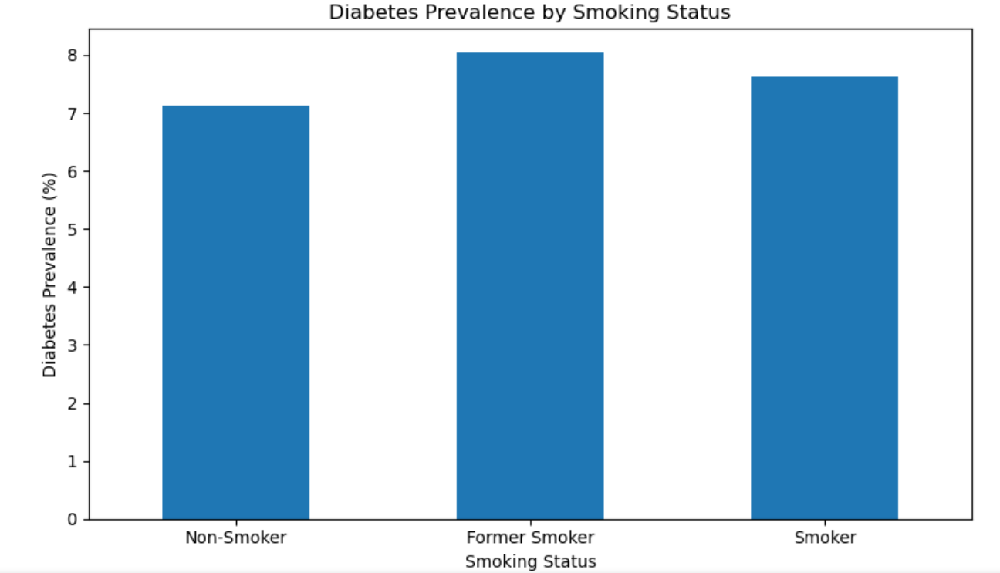
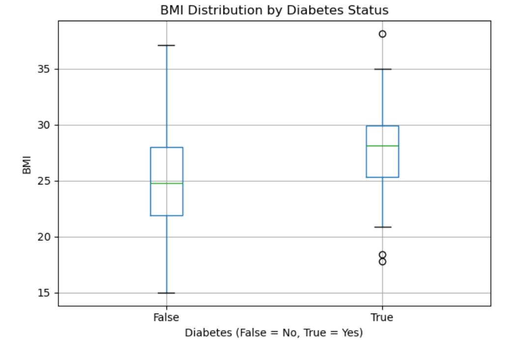
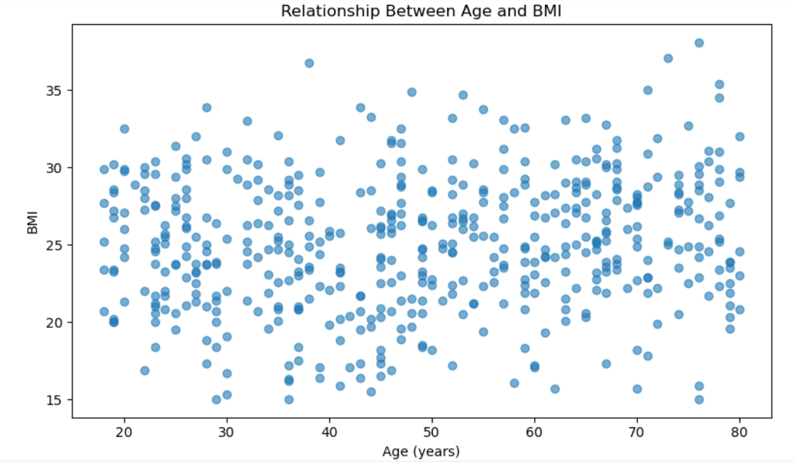

# Derivable Judgement — Statistical Analysis of Health Data

A Python-based statistical analysis project that explores relationships between health indicators and lifestyle factors using statistical hypothesis testing, descriptive statistics, correlation analysis, and data visualization.

The project demonstrates how Python can be used to analyze health-related data and identify statistical patterns involving diabetes, hypertension, smoking status, age, BMI, and exercise frequency.

> **Disclaimer:** This project is intended for educational purposes only. The dataset is described as synthetic in the notebook, and the results should not be treated as medical evidence, diagnosis, or proof of causation.

---
## Project Overview

**Derivable Judgement** is a statistical data analysis project developed using Python and Jupyter Notebook. It focuses on analyzing health-related variables and applying statistical techniques to investigate relationships between different health conditions and lifestyle factors.

The project follows a structured analytical workflow:

1. Load and inspect the dataset.
2. Examine dataset dimensions, data types, missing values, and descriptive statistics.
3. Perform statistical hypothesis tests.
4. Calculate confidence intervals and correlation coefficients.
5. Visualize patterns using charts.
6. Interpret statistical results using a significance level of 0.05.

The objective is to demonstrate the practical application of statistical methods in Python and understand how data analysis can support evidence-based decision-making.

## Project Objectives

- Understand the structure and characteristics of health-related data.
- Analyze diabetes prevalence across different smoking-status groups.
- Compare BMI distributions between people with and without diabetes.
- Investigate the relationship between age and BMI.
- Examine the association between smoking status and diabetes using a Chi-square test.
- Compare mean BMI values using Welch's independent-samples t-test.
- Calculate a 95% confidence interval for the mean age.
- Analyze diabetes rates across different age groups.
- Investigate the association between exercise frequency and hypertension.
- Calculate covariance and Pearson's correlation coefficient.
- Develop practical experience with Python-based statistical analysis and visualization.

## Technologies and Libraries

| Technology | Purpose |
|---|---|
| Python | Main programming language for data analysis |
| Jupyter Notebook | Interactive environment for executing code and documenting results |
| Pandas | Data loading, filtering, grouping, cross-tabulation, and descriptive statistics |
| NumPy | Numerical calculations and array operations |
| Matplotlib | Creating statistical charts and visualizations |
| SciPy | Statistical hypothesis testing, confidence intervals, and correlation analysis |

## Dataset Description

The project uses a health-related dataset containing demographic, lifestyle, and health indicators.

The expected dataset filename is:

`derivable_judgement_dataset.csv`

The dataset fields described in the notebook include:

| Column | Description |
|---|---|
| `record_id` | Unique identifier for a record |
| `age_group` | Age category used for grouped comparisons |
| `age` | Age in years |
| `weight` | Recorded weight |
| `gender` | Gender category |
| `region` | Region category |
| `smoking_status` | Smoking category, such as Smoker, Non-Smoker, or Former Smoker |
| `exercise_frequency` | Reported exercise-frequency category |
| `bmi` | Body Mass Index |
| `blood_pressure` | Recorded blood-pressure measurement |
| `diabetes` | Boolean indicator of diabetes status |
| `hypertension` | Boolean indicator of hypertension status |
| `cholesterol_level` | Recorded cholesterol measurement |
| `glucose_level` | Recorded glucose measurement |
| `visit_date` | Date associated with the record |

### Data Inspection

The notebook performs initial data inspection to understand the dataset before conducting statistical analysis.

This includes:

- Displaying the first five records.
- Checking the number of rows and columns.
- Identifying missing values.
- Generating descriptive statistics for selected numerical variables.
- Converting diabetes and hypertension values into Boolean format when necessary.

**Note:** The notebook contains a fallback mechanism that generates a synthetic dataset of 500 records if its configured CSV path is unavailable. For reproducible results on GitHub, ensure that the intended CSV is loaded instead of accidentally analyzing generated fallback data.

## Statistical Methods

### 1. Chi-Square Test of Independence: Smoking Status and Diabetes

This test investigates whether smoking status and diabetes status are statistically associated.

**Hypotheses:**

- **Null hypothesis (H₀):** Smoking status and diabetes are independent.
- **Alternative hypothesis (H₁):** Smoking status and diabetes are associated.

The analysis creates a contingency table and calculates the Chi-square statistic, degrees of freedom, critical value, and p-value.

The decision is based on a significance level of 0.05.

### 2. Welch's Independent-Samples T-Test: BMI and Diabetes

This test compares the average BMI of two groups:

- Records with diabetes.
- Records without diabetes.

Welch's t-test is used because it does not require the two groups to have equal population variances.

**Hypotheses:**

- **H₀:** The mean BMI is equal in both groups.
- **H₁:** The mean BMI differs between the groups.

The notebook calculates the t-statistic, degrees of freedom, critical t-value, and p-value to evaluate the difference in mean BMI.

### 3. Confidence Interval for Mean Age

The notebook calculates a 95% confidence interval for the population mean age using the sample mean, standard error, and a t-distribution-based critical value.

This interval represents the uncertainty associated with estimating the population mean from the available sample.

It does not mean that 95% of individual ages fall inside the calculated interval.

### 4. One-Way ANOVA: Diabetes Indicator Across Age Groups

This analysis compares the mean diabetes indicator across five age categories:

- 18–25
- 26–35
- 36–45
- 46–60
- 60+

Since the diabetes indicator is represented as a Boolean value, its group mean corresponds to the observed proportion of diabetes-positive records in that age group.

**Hypotheses:**

- **H₀:** The mean diabetes indicator is equal across all age groups.
- **H₁:** At least one age group has a different mean diabetes indicator.

The notebook reports the F-statistic, critical F-value, p-value, and statistical decision.

**Methodological note:** ANOVA is the method implemented in the notebook. For a more rigorous analysis of a binary outcome, logistic regression or another suitable categorical-data method may be preferable.

### 5. Covariance and Pearson Correlation: Age and BMI

This analysis examines the relationship between age and BMI.

The notebook calculates:

- Covariance between age and BMI.
- Pearson's correlation coefficient.
- The p-value associated with the correlation.
- A qualitative interpretation of the correlation's strength.

The notebook classifies the absolute correlation coefficient using these thresholds:

| Absolute correlation | Interpretation |
|---|---|
| Below 0.30 | Weak |
| 0.30 to below 0.70 | Moderate |
| 0.70 or above | Strong |

A positive coefficient indicates a positive linear association, while a negative coefficient indicates a negative linear association.

Correlation does not establish causation.

### 6. Chi-Square Test: Exercise Frequency and Hypertension

This test investigates whether exercise frequency and hypertension status are statistically associated.

**Hypotheses:**

- **H₀:** Exercise frequency and hypertension are independent.
- **H₁:** Exercise frequency and hypertension are associated.

The notebook creates a contingency table and calculates the Chi-square statistic, degrees of freedom, critical value, and p-value.

The final decision uses a significance level of 0.05.

## Data Visualization and Insights

The following three visualizations illustrate patterns in the supplied charts.

### 1. Diabetes Prevalence by Smoking Status



**Chart type:** Bar chart

**Purpose:** To compare the observed percentage of diabetes-positive records across smoking-status groups.

The chart contains three categories:

- Non-Smoker
- Former Smoker
- Smoker

**Observations:**

- The Former Smoker group has the highest bar in the supplied chart.
- The Smoker group has a slightly lower observed prevalence.
- The Non-Smoker group has the lowest observed prevalence among the three categories.

**Interpretation:**

The chart suggests differences in observed diabetes prevalence across the smoking-status groups in the displayed data.

However, this comparison does not establish that smoking status causes diabetes. Sample size, age, lifestyle, and other variables may influence the observed pattern.

The Chi-square test provides a statistical assessment of the association between smoking status and diabetes.

### 2. BMI Distribution by Diabetes Status



**Chart type:** Box plot

**Purpose:** To compare BMI distributions between records with and without diabetes.

The chart displays two categories:

- `False` — No diabetes
- `True` — Diabetes present

**How to interpret the box plot:**

- The horizontal line inside each box represents the median.
- The box represents the interquartile range, containing the middle 50% of observations.
- The whiskers show the range covered by the box-plot rule.
- Individual points beyond the whiskers indicate potential outliers.

**Observations:**

- The diabetes-positive group has a higher median BMI in the supplied chart.
- The diabetes-negative group has a lower median BMI.
- Both groups show variation in BMI.
- The distributions overlap, meaning BMI alone cannot determine whether an individual has diabetes.
- The diabetes-positive group contains several potential outliers.

**Interpretation:**

The visualization suggests that BMI distributions differ between the two diabetes-status groups.

Welch's t-test in the notebook evaluates whether the difference in their mean BMI values is statistically significant for the analyzed data.

### 3. Relationship Between Age and BMI



**Chart type:** Scatter plot

**Purpose:** To explore the relationship between age and BMI.

- The horizontal axis represents age in years.
- The vertical axis represents BMI.
- Each point represents an observation.

**Observations:**

- BMI values vary considerably across the age range.
- Both relatively low and high BMI values occur among different age groups.
- The points are widely scattered.
- The chart does not show an obvious strong linear relationship.

**Interpretation:**

The scatter plot provides a visual overview of how BMI varies with age.

Pearson's correlation coefficient and its p-value provide a numerical assessment of the linear relationship. The statistical output should be used alongside the visualization when interpreting the association.

A scatter plot alone cannot establish whether age directly influences BMI.

## How to Run the Project

### Step 1: Clone the Repository

Replace the placeholder with your actual GitHub repository URL.

```bash
git clone <your-repository-url>
cd Derivable-Judgement
```

### Step 2: Install Python Dependencies

Install the required libraries:

```bash
pip install -r requirements.txt
```

The `requirements.txt` file can contain:

```text
pandas
numpy
matplotlib
scipy
jupyter
```

### Step 3: Add the Dataset

Upload the CSV file to the repository root:

`derivable_judgement_dataset.csv`

Ensure that the filename matches the one used by the notebook.

For a portable GitHub project, use a repository-relative file path instead of a computer-specific Windows path.

For example:

```python
from pathlib import Path
import pandas as pd

file_path = Path("derivable_judgement_dataset.csv")
df = pd.read_csv(file_path)
```

Update the existing data-loading section to use the appropriate path.

### Step 4: Open the Jupyter Notebook

Run:

```bash
jupyter notebook Derivable_Judgement.ipynb
```

Open the notebook in your browser and execute the cells in order.

### Step 5: Review the Results

After running the notebook, review:

- Dataset dimensions and missing values.
- Descriptive statistics.
- Hypothesis-test results.
- Confidence interval for mean age.
- Correlation between age and BMI.
- Statistical visualizations.
- Final summary statistics.

If you use a different CSV dataset, regenerate the charts and update the README descriptions if the observed results change.

## Understanding Statistical Results

The notebook uses a significance level of:

**α = 0.05**

The general decision rule is:

| Condition | Decision |
|---|---|
| p-value < 0.05 | Reject the null hypothesis |
| p-value ≥ 0.05 | Fail to reject the null hypothesis |

A p-value below 0.05 indicates statistically significant evidence against the null hypothesis under the test's assumptions.

A p-value at or above 0.05 does not prove that no association or difference exists.

Statistical significance also does not automatically imply that an observed difference is large, practically important, or causal.

The notebook's final summary reports key descriptive measures, including the number of records, diabetes-positive records, hypertension-positive records, mean age, mean BMI, and the significance level used.

## Repository Structure

The following structure organizes the notebook, dataset, theory notes, documentation, dependencies, and visualization images in one GitHub repository.

```text
   Derivable-Judgement/
│
├── Derivable_Judgement.ipynb
├── derivable_judgement_dataset.csv
├── Theory_Notes.pdf
├── README.md
└── images/
    ├── PI1.png
    ├── PI2.png
    └── PI3.png
```
### File Descriptions

| File or folder | Description |
|---|---|
| `Derivable_Judgement.ipynb` | Main Jupyter Notebook containing data preparation, statistical calculations, hypothesis tests, visualizations, and summary results |
| `derivable_judgement_dataset.csv` | CSV dataset used for statistical analysis |
| `Theory_Notes.pdf` | Supporting theory notes for the project |
| `README.md` | Project documentation, methodology, chart explanations, setup instructions, and repository structure |
| `requirements.txt` | Python dependencies needed to execute the notebook |
| `images/` | Folder containing graph images displayed in the README and any additional visualizations |

**Important image note:** The three supplied graphs correspond to diabetes prevalence by smoking status, BMI distribution by diabetes status, and age versus BMI. The additional heatmap, glucose distribution, blood-pressure-by-age chart, and correlation matrix are included in the proposed folder structure but are not among the three supplied graph images. Upload those additional images only if you create them.

The README image paths must match the actual filenames in your GitHub repository. GitHub will not display a graph if its referenced image is missing or named differently.

## Limitations

- The notebook describes the dataset as synthetic and intended for educational analysis.
- Results from synthetic data should not be generalized to real-world populations.
- The notebook's fallback data-generation mechanism may run if the configured CSV path cannot be found.
- A computer-specific file path can prevent the notebook from running on other machines.
- Statistical tests depend on the dataset, sample size, data quality, and test assumptions.
- Observed associations do not establish causation.
- ANOVA on a binary diabetes indicator is included because it is implemented in the notebook, but other statistical models may be more suitable for analyzing binary outcomes.
- The supplied graphs provide descriptive insights; inferential conclusions should be based on the corresponding statistical results.

## Future Improvements

- Use a relative dataset path for portability.
- Add a detailed data dictionary and explain the dataset's source or generation process.
- Save graph outputs automatically into the `images/` directory.
- Add the proposed additional charts after implementing and validating them.
- Include effect sizes and confidence intervals alongside p-values.
- Consider logistic regression for diabetes and hypertension outcomes.
- Add data validation for missing values, unexpected categories, and invalid numerical ranges.
- Improve the final report by linking each statistical result to its corresponding business or analytical question.

## Conclusion

The **Derivable Judgement** project demonstrates how Python can be used to inspect health-related data, apply statistical tests, calculate confidence intervals, examine correlations, and visualize patterns.

The three supplied charts explore diabetes prevalence by smoking status, BMI distributions by diabetes status, and the relationship between age and BMI. Together with the notebook's statistical methods, they provide a practical introduction to statistical reasoning and evidence-based interpretation.

The project also provides a foundation for further learning in Python, data analysis, statistics, and data visualization.

---

## Disclaimer

This project is intended for educational purposes and statistical learning only. It is not a clinical tool and must not be used for medical diagnosis, treatment, or personal health decisions. Findings depend on the dataset and methods used. Statistical association does not prove causation.
